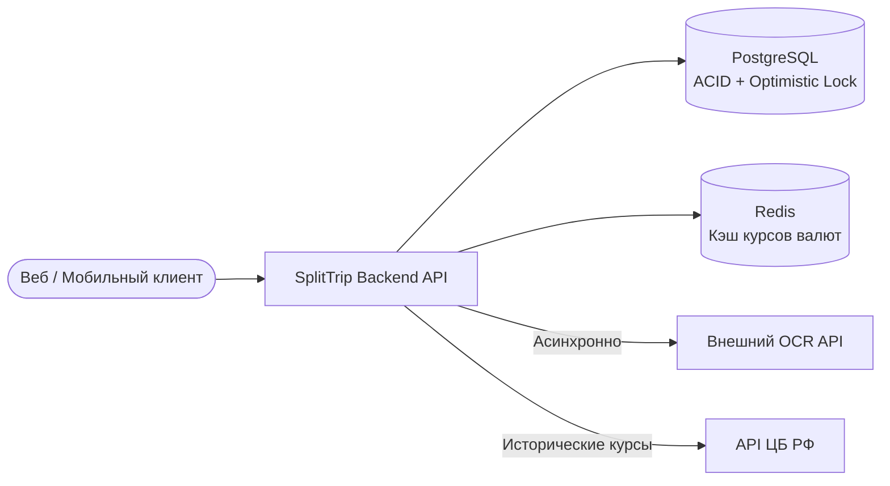

# splittrip-system-analysis
# SplitTrip — Система учета и разделения групповых расходов


Проектная документация и технический прототип (PoC) сервиса для учета совместных расходов в поездках. Система предназначена для автоматического распознавания товарных позиций из чеков через внешний OCR-сервис, конвертации мультивалютных трат по историческим курсам и минимизации количества переводов при взаиморасчетах.

## Решаемые задачи

1. **Автоматизация ввода данных:** парсинг позиций, налогов и чаевых с фотографий бумажных чеков с выделением строк, требующих ручной проверки.
2. **Точность финансовых расчетов:** исключение ошибок округления при делении неделимых сумм между участниками и при конвертации валют.
3. **Учет состава группы:** корректное распределение общих трат при присоединении или выбытии отдельных участников в середине поездки.
4. **Оптимизация взаиморасчетов:** сведение матрицы взаимных долгов к минимальному графу транзакций.

## Структура репозитория

Документация разделена по артефактам системного анализа и находится в директории `docs/`. Исполняемый код проверки гипотез вынесен в `poc/`.

| Файл | Назначение | Содержание |
| :--- | :--- | :--- |
| [docs/01_SRS.md](./docs/01_SRS.md) | Спецификация требований (SRS) | Функциональные и нефункциональные требования, правила округления, требования безопасности (152-ФЗ, GDPR) и целостности данных. |
| [docs/02_Use_Cases.md](./docs/02_Use_Cases.md) | Варианты использования | UML Use Case диаграмма, описание ролей (Организатор, Участник, Гость), основной и альтернативные потоки. |
| [docs/03_Backlog.md](./docs/03_Backlog.md) | Бэклог разработки | Декомпозиция функциональности на User Stories с критериями приемки (Acceptance Criteria) в нотации Gherkin. |
| [docs/04_Test_Plan_PMI.md](./docs/04_Test_Plan_PMI.md) | Программа и методика испытаний | Чек-лист граничных случаев и таблица тест-кейсов для проверки расчетного ядра. |
| [poc/currency_split_poc.py](./poc/currency_split_poc.py) | Прототип (PoC) | Скрипт на Python для проверки интеграции с API ЦБ РФ, обработки выходных дней и точного распределения остатка. |

## Ключевые архитектурные и логические решения

* **Распределение остатка при делении (Method of Largest Remainder):** все денежные операции выполняются в минорных единицах валюты (копейках, центах) с использованием типа `Decimal`. Неделимый остаток распределяется по 1 копейке так, чтобы сумма долей участников строго равнялась исходной сумме чека.
* **Обработка курсов валют:** при создании траты в иностранной валюте курс запрашивается на дату чека. Если на эту дату торги не проводились, система использует последний актуальный курс за предшествующий рабочий день. Предусмотрена возможность ручного переопределения курса пользователем.
* **Алгоритм сведения долгов (Debt Simplification):** расчет чистого баланса каждого участника в базовой валюте поездки и формирование минимального списка переводов с помощью жадного алгоритма сопоставления максимальных кредиторов и должников.
* **Конкурентный доступ:** изменение состава участников чека или суммы траты защищено оптимистичной блокировкой (Optimistic Locking) на уровне базы данных для предотвращения состояния гонки (Race Condition).

## Схема взаимодействия компонентов



## Запуск PoC-скрипта

Скрипт использует только стандартную библиотеку Python 3.10+ и не требует установки сторонних пакетов.

```bash
git clone https://github.com
cd splittrip-system-analysis/poc
python currency_split_poc.py
```

## Контакты

* Автор: [Имя Фамилия]
* Telegram: `@username`
* Email: `email@example.com`
