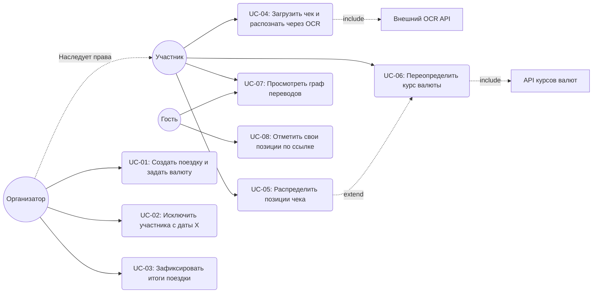

# Варианты использования (Use Cases)
**Проект:** SplitTrip — Сервис учета и разделения групповых расходов  
**Версия документа:** 1.0  

---

## 1. Ролевая модель (Actors)

| Актор | Описание и уровень прав |
| :--- | :--- |
| **Организатор поездки (Organizer)** | Создатель пространства поездки. Обладает полными правами: управление базовой валютой, приглашение и исключение участников, фиксация дат выбытия, закрытие поездки для редактирования. Наследует все права Участника. |
| **Участник (Participant)** | Авторизованный пользователь. Может добавлять чеки (вручную и через OCR), редактировать свои траты, распределять позиции, менять курс валюты для своих чеков и просматривать итоговый граф переводов. |
| **Гость (Guest)** | Неавторизованный пользователь, перешедший по ссылке-приглашению. Имеет доступ в режиме `Claim-Items`: может выбрать свое имя из списка виртуальных участников и отметить позиции, которые он потреблял, а также посмотреть свой итоговый долг. |
| **Внешний OCR API** | Внешний сервис оптического распознавания текста (вторичный актор). Принимает изображение чека и возвращает структурированный JSON с позициями. |
| **API курсов валют** | Внешний сервис (ЦБ РФ / ЕЦБ) для получения исторических курсов валют на дату совершения траты (вторичный актор). |

---

## 2. Диаграмма вариантов использования (UML Use Case)

---

## 3. Детальные сценарии использования

### UC-04: Загрузка фото чека и распознавание позиций (OCR)
* **Основной актор:** Участник (или Организатор).
* **Вторичный актор:** Внешний OCR API.
* **Предусловия:** Пользователь авторизован и состоит в активной поездке.
* **Постусловия:** В поездке создана новая трата со списком распознанных позиций; баланс поездки пересчитан.

**Основной поток (Basic Flow):**
1. Участник нажимает кнопку «Добавить чек» и загружает фотографию бумажного чека (формат JPEG/PNG, до 10 МБ).
2. Система удаляет EXIF-метаданные, маскирует чувствительные данные (номер карты) и сохраняет файл в S3.
3. Система отправляет изображение во внешний OCR API и переводит чек в статус `PROCESSING`.
4. OCR API возвращает распознанный JSON (список блюд, цены, налоги, дата и валюта чека).
5. Система проверяет совпадение суммы позиций с итоговой суммой чека (`total_amount`).
6. Система отображает экран предпросмотра чека. Участник проверяет позиции, выбирает плательщика и переходит к распределению долей (`UC-05`).

**Альтернативные потоки (Alternative Flows):**
* **А1 (Низкая уверенность распознавания):** На шаге 4 для одной из позиций возвращается `confidence < 0.85`. Система подсвечивает строку желтым цветом и требует от Участника подтвердить или исправить сумму перед сохранением.
* **А2 (Расхождение контрольной суммы):** На шаге 5 сумма распознанных позиций меньше `total_amount` на `150.00 RUB` (например, из-за смазанной строки). Система автоматически добавляет строку «Нераспределенный остаток: 150.00 RUB» для ручного заполнения.
* **А3 (Ошибка или таймаут OCR API):** На шаге 3 внешний сервис не отвечает более `10 секунд` или возвращает ошибку `5xx`. Система переводит чек в статус `FAILED` и предлагает Участнику ввести позиции вручную.

---

### UC-05: Распределение позиций чека с учетом округления и чаевых
* **Основной актор:** Участник.
* **Предусловия:** Чек создан (вручную или через OCR), указана общая сумма, дата и валюта.
* **Постусловия:** Для каждой позиции зафиксированы потребители и их точные доли в базовой валюте поездки.

**Основной поток (Basic Flow):**
1. Участник выбирает способ разделения для каждой позиции (поровну, в долях или точных суммах) и отмечает потребителей.
2. Участник добавляет строку «Чаевые / Сервисный сбор» (например, `10%` от суммы чека).
3. Если валюта чека отличается от базовой валюты поездки, система запрашивает курс у API курсов валют на дату чека (`tx_date`) и конвертирует все суммы в базовую валюту.
4. Система распределяет чаевые пропорционально стоимости заказанных каждым участником позиций.
5. Система применяет алгоритм крупнейшего остатка (Method of Largest Remainder), распределяя неделимые копейки по 1 копейке между участниками.
6. Участник нажимает «Сохранить». Система записывает трату в БД в рамках ACID-транзакции и обновляет общий граф долгов.

**Альтернативные потоки (Alternative Flows):**
* **А1 (Выбывший участник):** При выборе опции «Разделить на всех» система проверяет даты активности (`joined_at`, `left_at`) и автоматически исключает участников, выбывших до даты `tx_date`.
* **А2 (Конфликт версий при одновременном редактировании):** Два участника одновременно редактируют один чек. При сохранении второго запроса система фиксирует несовпадение поля `version` (Optimistic Locking), отклоняет запрос с кодом `409 Conflict` и обновляет экран пользователя актуальными данными.

---

### UC-08: Отметка своих позиций Гостем без регистрации
* **Основной актор:** Гость.
* **Предусловия:** Организатор сгенерировал токен приглашения для поездки и передал ссылку Гостю.
* **Постусловия:** Зафиксированы доли Гостя в выбранных чеках; общий баланс поездки обновлен.

**Основной поток (Basic Flow):**
1. Гость открывает ссылку вида `https://splittrip.app{trip_id}?token={hmac_token}`.
2. Система проверяет валидность HMAC-подписи токена и статус поездки (поездка не закрыта).
3. Система отображает список виртуальных участников поездки, к которым еще не привязаны аккаунты. Гость выбирает свое имя (например, «Дмитрий»).
4. Система сохраняет сессию Гостя в `localStorage` браузера и открывает список чеков поездки в режиме ограниченного доступа.
5. Гость открывает нужный чек и ставит отметки напротив позиций, которые он заказывал.
6. Система пересчитывает доли по позициям (применяя правило округления копеек) и отображает Гостю сумму его итогового долга и реквизиты для перевода (если разрешено настройками поездки).

**Альтернативные потоки (Alternative Flows):**
* **А1 (Невалидный или отозванный токен):** На шаге 2 подпись токена не совпадает или Организатор отозвал ссылку. Система возвращает страницу ошибки `403 Forbidden` с сообщением «Ссылка недействительна».
* **А2 (Попытка изменения настроек):** Гость пытается отправить API-запрос на удаление чека или изменение курса валют. Система блокирует действие на уровне RBAC (`403 Forbidden`).
